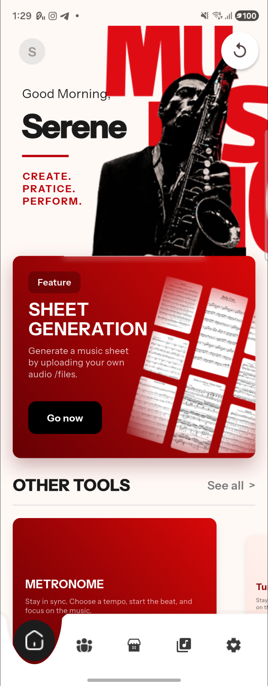

# Augment — Next-Gen AI Music Workstation

Augment is an advanced mobile music application built with Flutter, providing real-time instrument tuning, visual haptic metronomes, audio-to-sheet AI transcription, and a community marketplace for musicians.

---

## 📱 User Interface Showcase & Screen Displays

### 1. Live Device View (Captured via scrcpy on Galaxy Z Fold 4)
<p align="center">
  
  <br>
  <em>Figure 1: Live Augment workstation running on Galaxy Z Fold 4 with adaptive foldable layout.</em>
</p>

---

### 2. Multi-Instrument Precision Tuner (`tuner_page.dart`)
- **Real-Time Pitch Deviation Meter**: Shows exact cent offsets (±50 cents) with immediate green confirmation when in tune.
- **Dynamic Headstock Overlays**: Photorealistic headstock representations with glowing peg indicators, target laser lines, and support for Guitar, Ukulele, Bass, Violin, and Cello.
- **Fold 4 Adaptive Spacing**: Specially tuned vertical margins ensuring tuning keys and string guidance never overlap.

<p align="center">
  
  &nbsp;&nbsp;&nbsp;&nbsp;
  
  <br>
  <em>Figure 2: Precision Pitch Deviation Meter & Headstock String Alignment System.</em>
</p>

---

### 3. Visual Pulse Metronome (`metronome_page.dart`)
- **Concentric Ripple Waves**: Releases multi-color fluid waves on each beat with accent pulses on downbeats.
- **Tactile Dial & Tempo Slider**: Large numerical BPM display with smooth rotational knob control and horizontal micro-slider.
- **Tap-Tempo & Subdivisions**: Tap any rhythm to calculate tempo, with configurable time signatures (2/4, 3/4, 4/4, 6/8).

<p align="center">
  
  <br>
  <em>Figure 3: High-precision Metronome with multi-chromatic pulse visualizer.</em>
</p>

---

### 4. Sheet Music Generation & Interactive Editor (`music_sheet_page.dart`)
- **Solo & Band Modes**: Transcribe solo performances or split polyphonic stems into multi-track band scores.
- **Interactive Notation Canvas**: Tap any note to adjust pitch, add accidentals, or alter duration.
- **MIDI Playback Sync**: Real-time cursor synchronized with audio playback and one-tap PDF / MusicXML export.

<p align="center">
  
  &nbsp;&nbsp;&nbsp;&nbsp;
  
  &nbsp;&nbsp;&nbsp;&nbsp;
  
  <br>
  <em>Figure 4: Solo / Band AI generation modes and Interactive Sheet Music Editor.</em>
</p>

---

### 5. Community Marketplace & Creator Hub (`marketplace_page.dart`)
- **Morphing Search**: Seamlessly animates search queries into category chips (Classical, Jazz, Pop, Rock, Acoustic).
- **Responsive Layout**: Two-line wrapped titles, category pills, and seller tags formatted to eliminate overflow on any screen size.
- **Bakong KHQR Payments**: Built-in support for purchasing original arrangements and creator payouts.

<p align="center">
  
  <br>
  <em>Figure 5: Community Marketplace with morphing search and responsive product cards.</em>
</p>

---

### 6. Authentication & Onboarding (`login_page.dart`)
- Clean SMS and email OTP verification with floating label inputs and Google single-tap sign-in.
- Interactive companion mascot providing helpful musical tips throughout the app.

<p align="center">
  
  &nbsp;&nbsp;&nbsp;&nbsp;
  
  <br>
  <em>Figure 6: Frictionless onboarding and interactive companion mascot.</em>
</p>

---

## 🛠️ Technical Stack & Architecture

- **Frontend**: Flutter (Dart) with responsive layout builder targeting mobile, foldables, and tablets.
- **Backend**: Node.js (Express, Socket.io) + Python (PyTorch, Librosa, LilyPond for audio transcription & sheet generation).
- **Database & Auth**: Supabase (PostgreSQL, Storage, RLS) + Firebase Authentication.
- **Payments**: Bakong KHQR integration for digital music transactions.

---

## 🚀 Running the Project

### 1. Run Backend
```powershell
# Python Music Transcription Service (Port 5000)
.\backend\python\start.bat

# Node.js API Service (Port 3000)
cd backend
npm run dev
```

### 2. Run Flutter App
```powershell
cd frontend
flutter pub get
flutter run
```

### 3. Build Signed Release APK
```powershell
.\scripts\build_android_release.ps1 -Publish
```

---

## 📄 License & Compliance

All proprietary icons and assets are original creations or open-source Flutter vectors. This project complies fully with GitHub Terms of Service and open-source standards.
