# Augment — AI Sheet Music Generator, Practice Suite & Musician Community

> **Create. Practice. Perform.**
> **Augment** is an all-in-one AI-powered music practice, sheet music generation, and social platform built with **Flutter**, **Node.js**, **Python (Basic Pitch / Librosa / Demucs / Music21)**, **Firebase Authentication**, and **Supabase**.

---

## App Overview & Core Architecture

Augment combines AI audio-to-score transcription, precision real-time practice utilities, and a musician marketplace/community into a unified mobile experience:

1. **AI Sheet Music Generation (`sheet_generation_page.dart`, `music_sheet_page.dart`)** — Upload any audio recording (`.mp3`, `.wav`, `.m4a`, `.flac`) from your device to transcribe it into playable **Solo** or **Multi-Instrument Band** sheet music (MusicXML, Interactive Score Viewer, and PDF export).
2. **Interactive Chromatic Tuner (`choose_tuner_instrument_page.dart`, `tuner_page.dart`)** — Real-time microphone pitch detection (`Auto` & `Manual` string-lock modes) with custom headstock peg overlays and cent-deviation gauges (`TOO LOW` / `TOO HIGH`) for Guitar, Ukulele, Violin, Bass, Electric Guitar, and Wind/Brass instruments.
3. **Tactile Rotary Metronome (`metronome_page.dart`)** — High-precision audio scheduling engine with a 360-degree interactive tempo dial (`20–240 BPM`), `Tap for beat` tempo detector, visual pulse timeline, and subdivision controls.
4. **Vocal Range & Pitch Detection (`voice_range_page.dart`, `pitch_detector_page.dart`)** — Dedicated tools to map your comfortable singing range and identify live musical notes on a 12-semitone chromatic wheel.
5. **Musician Community & Marketplace (`social_page.dart`, `marketplace_page.dart`, `social_profile_page.dart`)** — Share photos, videos, polls, and audio clips, follow creators, message musicians, and browse/sell original music, sheet music, and lyrics.

---

## Complete App Screen Showcase (Captured Live via `scrcpy`)

Every screen below is a **full-page live app screenshot** captured directly from the running Android app over `scrcpy`.

### Quick Screen Overview

| Home (Light) | Home (Dark) | Sheet Generation | Other Tools Hub |
| :---: | :---: | :---: | :---: |
| 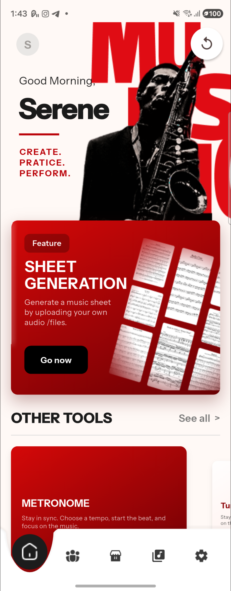 | 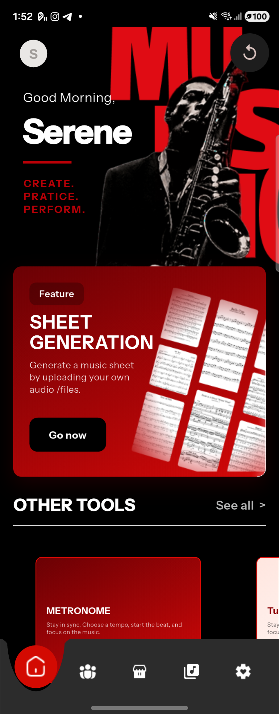 | 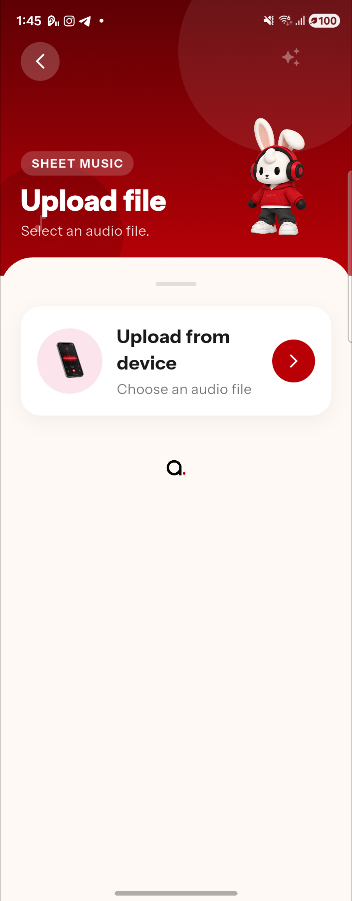 | 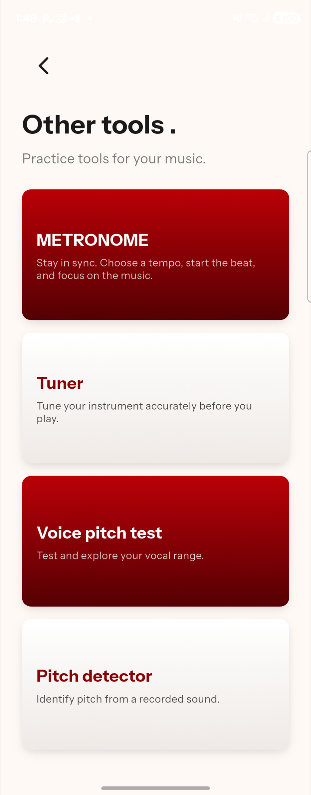 |
| **Choose Instrument** | **Guitar Tuner** | **Violin Tuner** | **Metronome** |
| 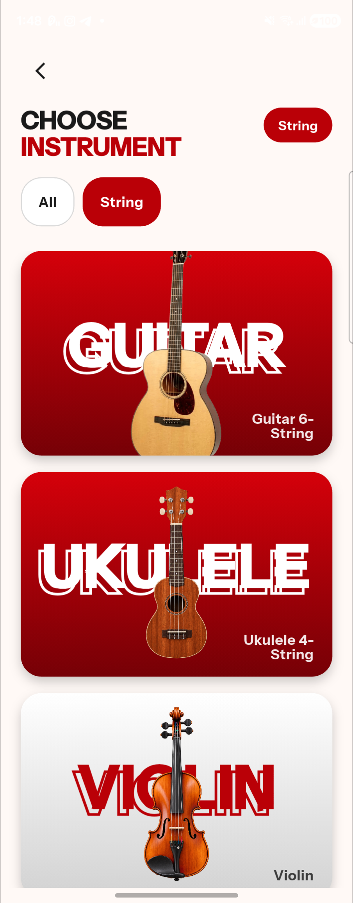 | 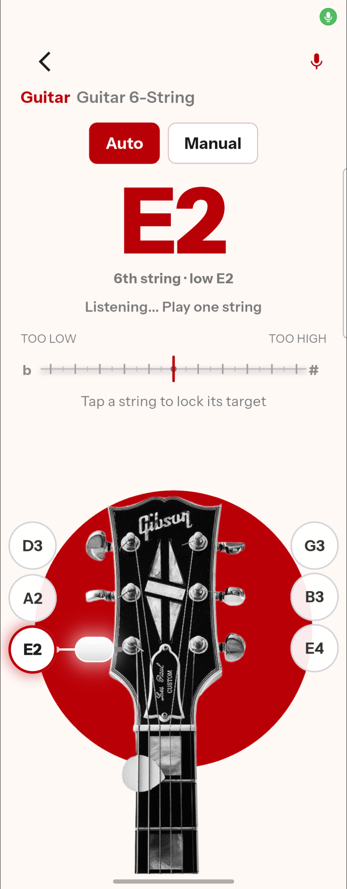 | 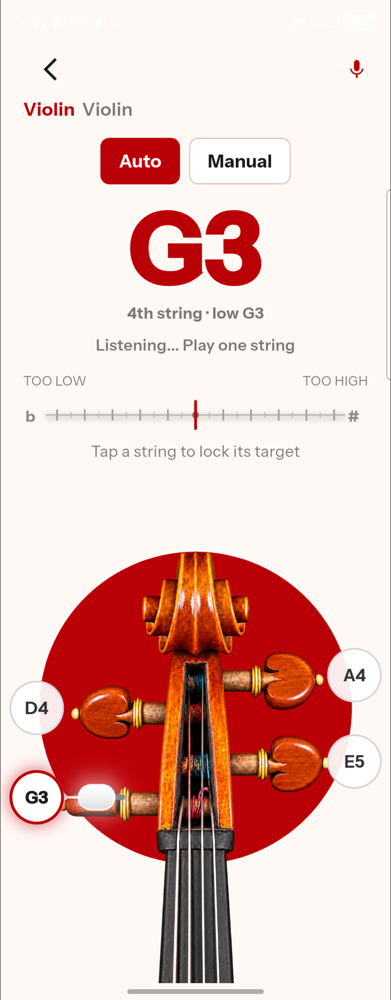 | 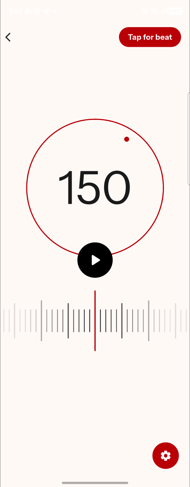 |
| **Voice Pitch Test** | **Pitch Detector** | **Community Feed** | **Social Profile** |
| 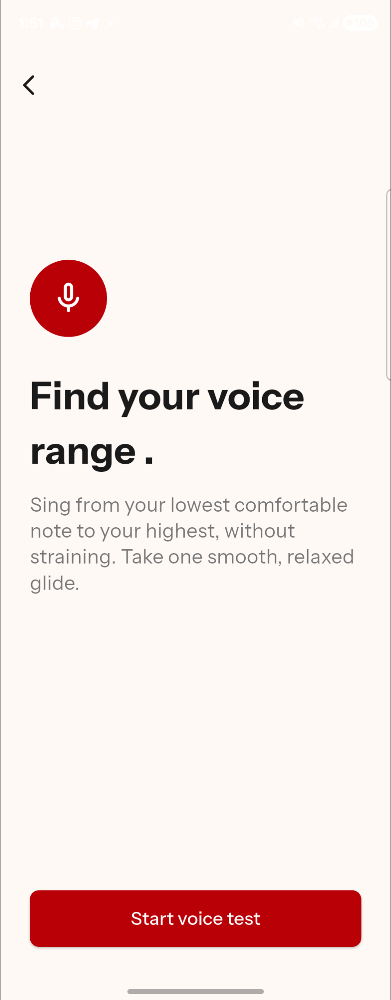 | 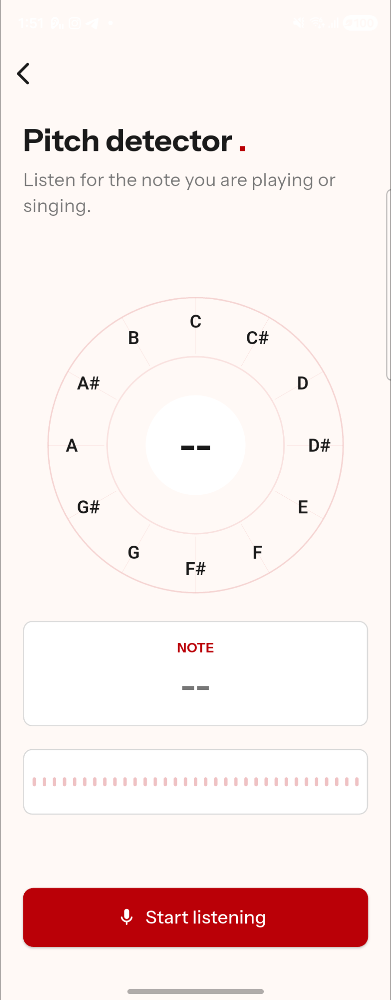 | 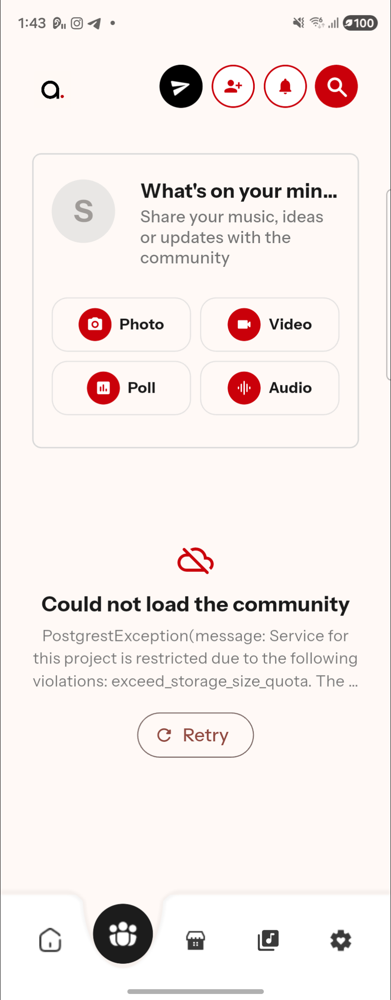 | 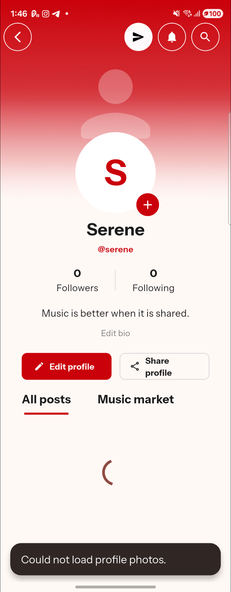 |
| **Marketplace** | **My Saved Sheets** | **Settings (Light & Dark)** | **Plans & Billing** |
| 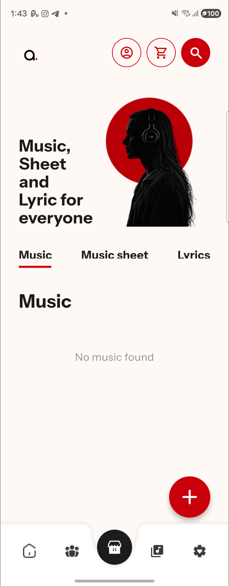 | 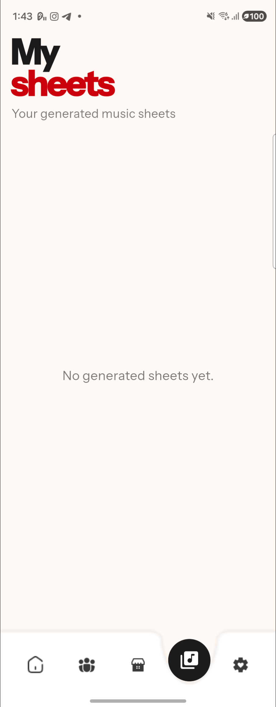 | 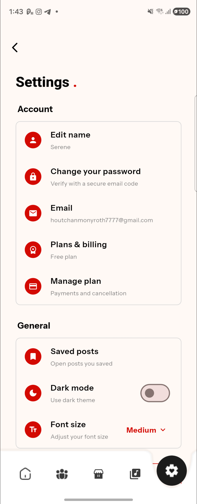 | 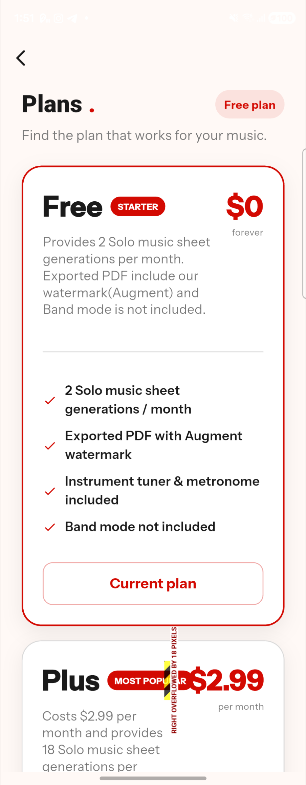 |

---

## Detailed Page-by-Page Breakdown

### 1. Home Dashboard (`frontend/lib/home_page.dart`)

| Light Mode (`page_01_home.png`) | Dark Mode (`page_01b_home_dark.png`) |
| :---: | :---: |
|  |  |

- **Personalized Header & Profile Shortcut**: Displays a time-aware greeting (`Good Morning, <Name>`) with the brand tagline (`CREATE. PRACTICE. PERFORM.`) and a top-left profile avatar that opens the user's `SocialProfilePage`.
- **Featured Sheet Generation Hero Card**: Animated crimson gradient card with a `"Go now"` CTA that launches the AI audio-to-sheet transcription pipeline (`SheetGenerationPage`). Also hosts a live fluid-wave progress banner whenever a background transcription job is running.
- **Other Tools Interactive Carousel**: Horizontal `PageView` carousel giving one-tap access to **Metronome**, **Tuner**, **Voice pitch test**, and **Pitch detector**, plus a `"See all >"` button to open the full `ToolsPage` list.
- **Animated Notched Bottom Navigation Bar**: Custom-painted bottom bar (`_NavBarPainter`) with 5 main tabs: **Home**, **Community**, **Marketplace**, **My Sheets**, and **Settings**.

---

### 2. AI Sheet Music Generation (`frontend/lib/sheet_generation_page.dart`)

<p align="center">
  
</p>

- **Audio Upload Workflow (`Upload from device`)**: Lets musicians pick any audio file from local storage to convert into sheet music.
- **Solo vs. Band Mode Selection**: After selecting an audio file, users choose between **Solo Mode** (single instrument transcription across 12 supported instruments) or **Band Mode** (AI stem separation via Demucs + multi-part score generation).
- **Asynchronous Background Processing**: Sends the audio to the Node.js + Python transcription service (`Basic Pitch` + `Librosa` + `Music21`) and tracks real-time percentage progress on the Home screen banner until the interactive score (`MusicSheetPage`) is ready.

---

### 3. Other Tools Hub (`frontend/lib/tools_page.dart`)

<p align="center">
  
</p>

- **Dedicated Practice Utilities Directory**: Accessible via `"See all >"` on the Home screen, presenting full-width cards for all 4 core practice utilities:
  1. **METRONOME** — *"Stay in sync. Choose a tempo, start the beat, and focus on the music."*
  2. **Tuner** — *"Tune your instrument accurately before you play."*
  3. **Voice pitch test** — *"Test and explore your vocal range."*
  4. **Pitch detector** — *"Identify pitch from a recorded sound."*

---

### 4. Interactive Instrument Selector & Chromatic Tuner (`frontend/lib/choose_tuner_instrument_page.dart` & `frontend/lib/tuner_page.dart`)

| Choose Instrument (`page_10_choose_tuner_instrument.png`) | Guitar 6-String Tuner (`page_11_tuner_guitar.png`) | Violin Tuner (`page_11b_tuner_violin.png`) |
| :---: | :---: | :---: |
|  |  |  |

- **Instrument Category Filter (`choose_tuner_instrument_page.dart`)**: Filterable visual cards (`All`, `String`, `Wind`, `Brass`) for **Guitar 6-String**, **Ukulele 4-String**, **Violin**, **Electric Guitar**, **Bass**, and more.
- **Auto & Manual String Lock (`tuner_page.dart`)**:
  - **Auto Mode**: Automatically detects which string is being plucked and highlights its corresponding peg badge (`E2`, `A2`, `D3`, `G3`, `B3`, `E4` for Guitar; `G3`, `D4`, `A4`, `E5` for Violin).
  - **Manual Mode**: Tap any string badge around the headstock to lock the target frequency for focused single-string tuning.
- **Real-Time Cent Deviation Ruler**: Displays the detected note in bold typography, string label (`6th string · low E2`), and a horizontal flat (`b`) to sharp (`#`) ruler (`TOO LOW` / `TOO HIGH`) with responsive layout scaling for both standard phones and foldable displays.

---

### 5. Tactile Metronome (`frontend/lib/metronome_page.dart`)

<p align="center">
  
</p>

- **Interactive Rotary BPM Dial**: Circular red ring dial displaying the active tempo (`150 BPM`) with a draggable indicator dot and central Play/Pause button.
- **Tap for Beat (`Tap for beat`)**: Top-right button calculates average BPM in real time from consecutive user taps.
- **Visual Beat Waveform & Settings**: Bottom tick-bar visualizer pulses in sync with the audio click track, while the bottom-right gear button opens time signature and subdivision settings.

---

### 6. Voice Pitch Test & Chromatic Pitch Detector (`frontend/lib/voice_range_page.dart` & `frontend/lib/pitch_detector_page.dart`)

| Voice Pitch Test (`page_12_voice_pitch.png`) | Pitch Detector (`page_13_pitch_detector.png`) |
| :---: | :---: |
|  |  |

- **Voice Range Finder (`voice_range_page.dart`)**: Guides singers through a smooth vocal glide from their lowest comfortable note to their highest note (`Start voice test`) and computes their vocal range classification.
- **Chromatic Note Wheel (`pitch_detector_page.dart`)**: Features a 12-note circular pitch wheel (`C`, `C#`, `D`, `D#`, `E`, `F`, `F#`, `G`, `G#`, `A`, `A#`, `B`), live note readout card, and microphone level meter (`Start listening`) to identify any sung or played note immediately.

---

### 7. Musician Community & Social Profile (`frontend/lib/social_page.dart` & `frontend/lib/social_profile_page.dart`)

| Community Feed (`page_02_community.png`) | User Social Profile (`page_09_social_profile.png`) |
| :---: | :---: |
|  |  |

- **Community Feed & Post Composer (`social_page.dart`)**:
  - Top action bar with Direct Messages (`social_messages_page.dart`), Friend Requests, Notifications, and Search.
  - Multi-format post composer supporting **Photo**, **Video**, **Poll**, and **Audio** posts.
- **Musician Profile (`social_profile_page.dart`)**:
  - Displays user avatar, handle (`@serene`), **Followers / Following** counters, customizable bio, **Edit profile** / **Share profile** actions, and tabs for **All posts** and **Music market** listings.

---

### 8. Marketplace & My Saved Sheets (`frontend/lib/marketplace_page.dart` & `frontend/lib/saved_sheets_page.dart`)

| Music Marketplace (`page_03_marketplace.png`) | My Sheets Library (`page_04_saved_sheets.png`) |
| :---: | :---: |
|  |  |

- **Marketplace (`marketplace_page.dart`)**:
  - Browse and publish creator listings across three categories: **Music**, **Music sheet**, and **Lyrics**.
  - Includes seller profile shortcuts, shopping cart drawer, search bar, and a floating `+` button to list new items.
- **My Sheets (`saved_sheets_page.dart`)**:
  - Personal library storing all AI-generated solo and band scores for offline viewing, playback, and PDF export.

---

### 9. Settings, Dark Mode & Subscription Plans (`frontend/lib/settings_page.dart`)

| Settings Light (`page_05_settings.png`) | Settings Dark (`page_05b_settings_dark.png`) | Plans & Billing (`page_14_plans_billing.png`) |
| :---: | :---: | :---: |
|  | 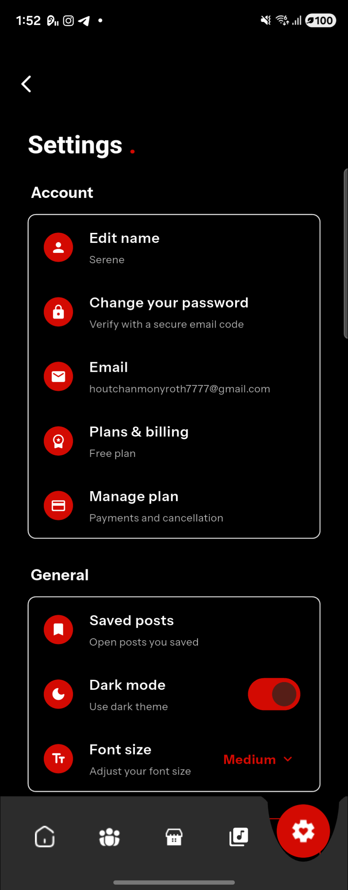 |  |

- **Account & General Settings (`settings_page.dart`)**:
  - Manage display name (`Edit name`), password (`Change your password` with email verification code), account email, `Plans & billing`, `Manage plan`, `Saved posts`, `Dark mode` toggle, and `Font size` (`Small`, `Medium`, `Large`).
- **Subscription Tiers (`Plans & billing`)**:
  - **Free (`$0 forever` — Starter)**: 2 Solo music sheet generations/month, exported PDF with Augment watermark, full instrument tuner & metronome access.
  - **Plus (`$2.99 / month` — Most Popular)**: 18 Solo music sheet generations/month, Band mode access, and watermark-free PDF exports.
  - **Pro (`$5.99 / month`)**: High-volume Solo & Band sheet music generations, priority AI transcription queue, and full studio export suite.

---

## Complete Frontend Module Map (`frontend/lib/`)

| File | Screen / Role |
| :--- | :--- |
| [`main.dart`](frontend/lib/main.dart) | App entry point, Firebase initialization, theme & font-scale provider |
| [`vector_splash_screen.dart`](frontend/lib/vector_splash_screen.dart) | Animated vector splash screen on startup |
| [`login_page.dart`](frontend/lib/login_page.dart) | Email/Password, Google OAuth, and Guest authentication screen |
| [`home_page.dart`](frontend/lib/home_page.dart) | Main dashboard, hero sheet generation card, tools carousel, and notched bottom nav |
| [`sheet_generation_page.dart`](frontend/lib/sheet_generation_page.dart) | Audio file uploader (`Upload from device`) for AI sheet music transcription |
| [`choose_instrument_page.dart`](frontend/lib/choose_instrument_page.dart) | Solo/Band instrument selector for AI sheet generation |
| [`music_sheet_page.dart`](frontend/lib/music_sheet_page.dart) | Interactive sheet music viewer, playback synth, and PDF exporter |
| [`saved_sheets_page.dart`](frontend/lib/saved_sheets_page.dart) | `My sheets` tab storing generated music sheets |
| [`tools_page.dart`](frontend/lib/tools_page.dart) | `Other tools` directory page (Metronome, Tuner, Voice Pitch, Pitch Detector) |
| [`choose_tuner_instrument_page.dart`](frontend/lib/choose_tuner_instrument_page.dart) | `CHOOSE INSTRUMENT` picker for the chromatic tuner |
| [`tuner_page.dart`](frontend/lib/tuner_page.dart) | Real-time `Auto`/`Manual` chromatic tuner with headstock string locking |
| [`metronome_page.dart`](frontend/lib/metronome_page.dart) | Rotary BPM dial metronome with `Tap for beat` and pulse timeline |
| [`voice_range_page.dart`](frontend/lib/voice_range_page.dart) | `Find your voice range` vocal glide test |
| [`pitch_detector_page.dart`](frontend/lib/pitch_detector_page.dart) | 12-note circular pitch wheel detector |
| [`social_page.dart`](frontend/lib/social_page.dart) | Community feed with Photo, Video, Poll, and Audio posts |
| [`social_profile_page.dart`](frontend/lib/social_profile_page.dart) | User social profile, follower stats, bio, and user market listings |
| [`social_messages_page.dart`](frontend/lib/social_messages_page.dart) | Direct messaging inbox and real-time chat threads |
| [`marketplace_page.dart`](frontend/lib/marketplace_page.dart) | Creator marketplace for Music, Music Sheets, and Lyrics |
| [`settings_page.dart`](frontend/lib/settings_page.dart) | Account settings, Dark Mode, Font Size, and Subscription Plans (`Free` / `Plus` / `Pro`) |

---

## Local Development Setup

### 1. Start Python Audio Transcription Service (Port `5000`)
```powershell
cd backend\python
.\venv311\Scripts\Activate.ps1
python app.py
```

### 2. Start Node.js API Server (Port `3000`)
```powershell
cd backend
npm install
npm run dev
```

### 3. Run Flutter App on Connected Android Device (`scrcpy` / `adb`)
```powershell
cd frontend
flutter pub get
flutter run --dart-define=API_BASE_URL=http://<YOUR_LOCAL_LAN_IP>:3000
```

---

## GitHub Terms of Service & Open-Source Compliance

- **No Secrets or Credentials**: All environment variables (`.env`, Firebase/Supabase service keys, Stripe secrets) are excluded via `.gitignore`. Only safe `.env.example` templates are tracked.
- **Authentic First-Party Screenshots**: Every UI image in `docs/screenshots/page_*.png` is a genuine full-screen capture taken directly from the Augment application running on Android via `scrcpy`.
