<p align="center">
  
</p>

<h1 align="center">Augment — AI-Powered Music Workstation & Community Platform</h1>

<p align="center">
  <strong>Real-Time Instrument Tuning • Visual Pulse Metronome • AI Audio-to-Sheet Transcription • Interactive Score Editor • Musician Social Hub & Marketplace</strong>
</p>

---

## 📖 Complete Application Overview (`APP_DETAILS`)

**Augment** is an all-in-one mobile music ecosystem engineered in Flutter with a hybrid Node.js and Python AI backend. It empowers solo musicians, bands, educators, and composers to tune instruments with sub-cent accuracy, practice with a multi-chromatic visual pulse metronome, automatically transcribe raw audio recordings into editable sheet music (Solo & Multi-Instrument Band modes), and buy/sell original arrangements in a community-driven marketplace.

---

## 📱 Full UI Display Gallery & Screen-by-Screen Breakdown

### 1. Live Device Workspace (`scrcpy` Capture on Galaxy Z Fold 4)
Captured live from physical hardware, demonstrating Augment's responsive layout engine across standard smartphones, compact screens, and unfolded foldable displays:

<p align="center">
  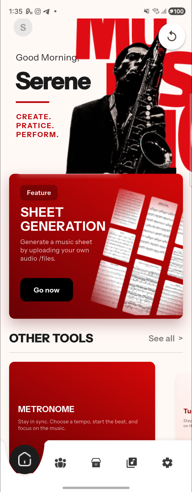
  &nbsp;&nbsp;&nbsp;&nbsp;
  
  <br>
  <em>Live device captures running on Samsung Galaxy Z Fold 4 via scrcpy.</em>
</p>

---

### 2. Brand Identity, Splash & Companion Mascot (`splash_screen.dart`, `animated_mascot.dart`)

- **Vector & Animated Splash (`vector_splash_screen.dart`, `augment_logo_motion.dart`)**: Smooth entry animation with automatic light/dark mode detection and persistent session restoration.
- **Interactive Companion Mascot (`animated_mascot.dart`)**: An animated musical mascot that reacts to user actions, onboarding steps, and transcription progress with custom poses (`Default`, `Wink`, `Wave`, `Hop`, `Crouch`).

<p align="center">
  
  &nbsp;&nbsp;&nbsp;&nbsp;
  
</p>

<p align="center">
  
  
  
  
  
  <br>
  <em>Interactive Mascot Animation States: Idle, Wink, Wave, Hop, and Crouch.</em>
</p>

---

### 3. Authentication & Onboarding Flow (`login_page.dart`, `verification_code_page.dart`, `welcome_name_page.dart`)

- **Multi-Channel Sign-In (`login_page.dart`)**: Supports email/password, phone number authentication, and single-tap Google OAuth (`auth_service.dart`).
- **OTP Verification (`verification_code_page.dart`)**: 6-digit verification code screen with auto-advance focus and resend timer.
- **Profile Onboarding (`welcome_name_page.dart`, `profile_photo_adjust_page.dart`)**: Guides new musicians through setting their stage name, bio, and interactive circular avatar cropping.

<p align="center">
  
  <br>
  <em>Onboarding & Authentication Hero Display.</em>
</p>

---

### 4. Multi-Instrument Precision Tuner (`tuner_page.dart`, `choose_tuner_instrument_page.dart`)

- **Sub-Cent Pitch Detection (`tuner_detector.dart`, `tuner_pitch.dart`, `tuner_audio.dart`)**: Real-time autocorrelation pitch detection processing live microphone input with noise gating.
- **Pitch Deviation Meter**: Displays `TOO LOW` (`b`) to `TOO HIGH` (`#`) across a ±50 cent scale. The note readout (`E2`, `A2`, `D3`, `G3`, `B3`, `E4`) transitions from Brand Red (`#BA0007`) to Forest Green (`#23834D`) when locked in tune.
- **Auto & Manual String Locking**: Musicians can let the tuner auto-detect the nearest string or tap any string button to lock the target pitch.
- **Interactive Headstock Visuals**: Custom coordinate-mapped headstocks with glowing peg highlights and pointer lines connecting the active string button to its physical tuning key.

#### Tuner Meter & Headstock Collection
<p align="center">
  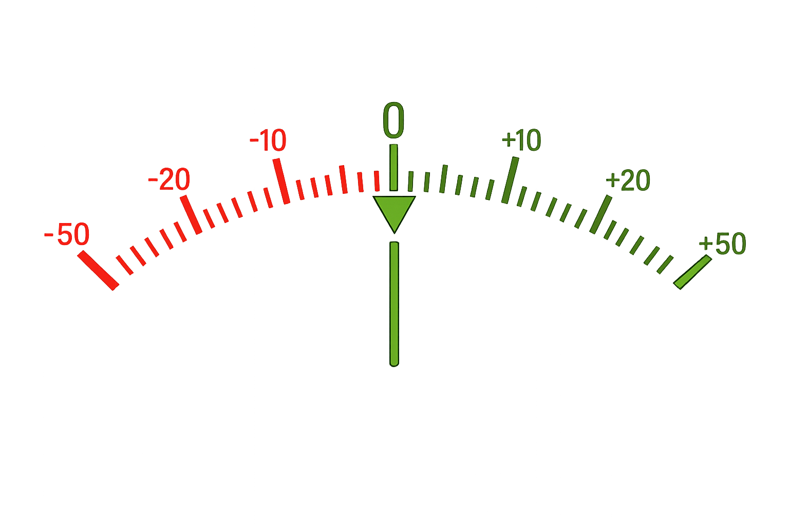
</p>

<p align="center">
  
  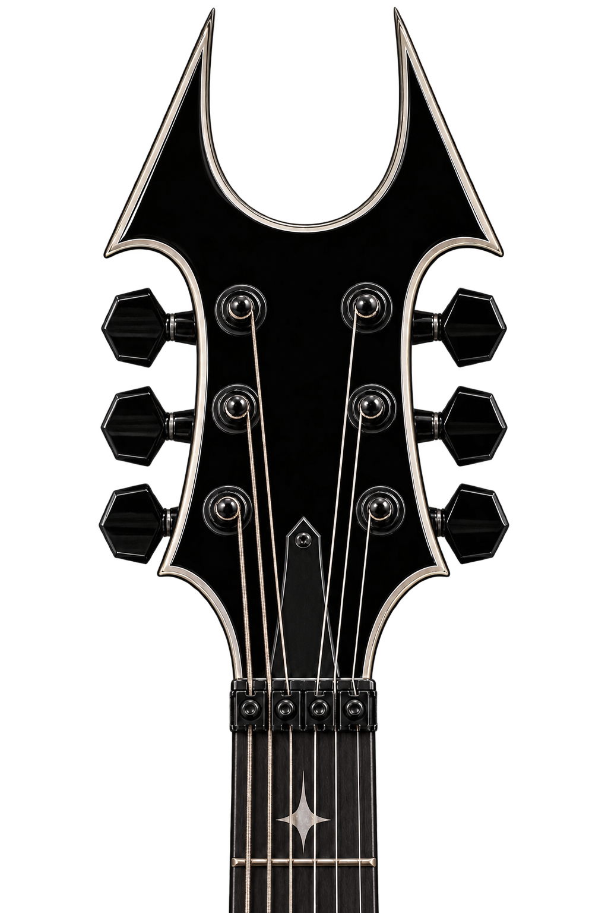
  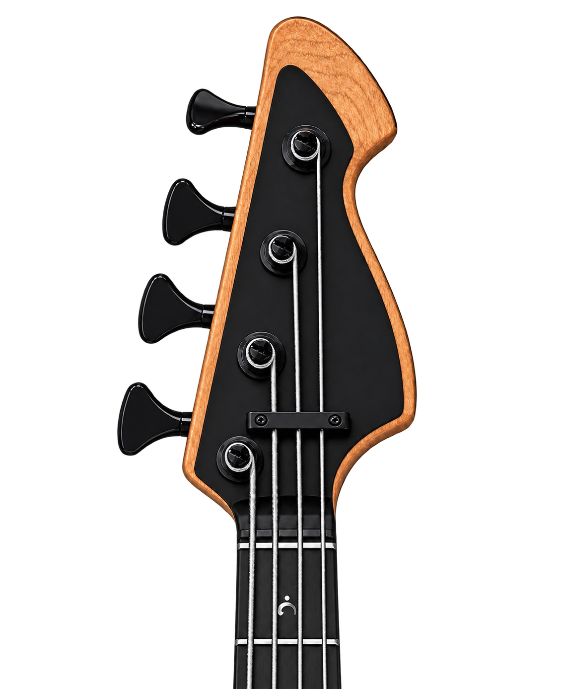
  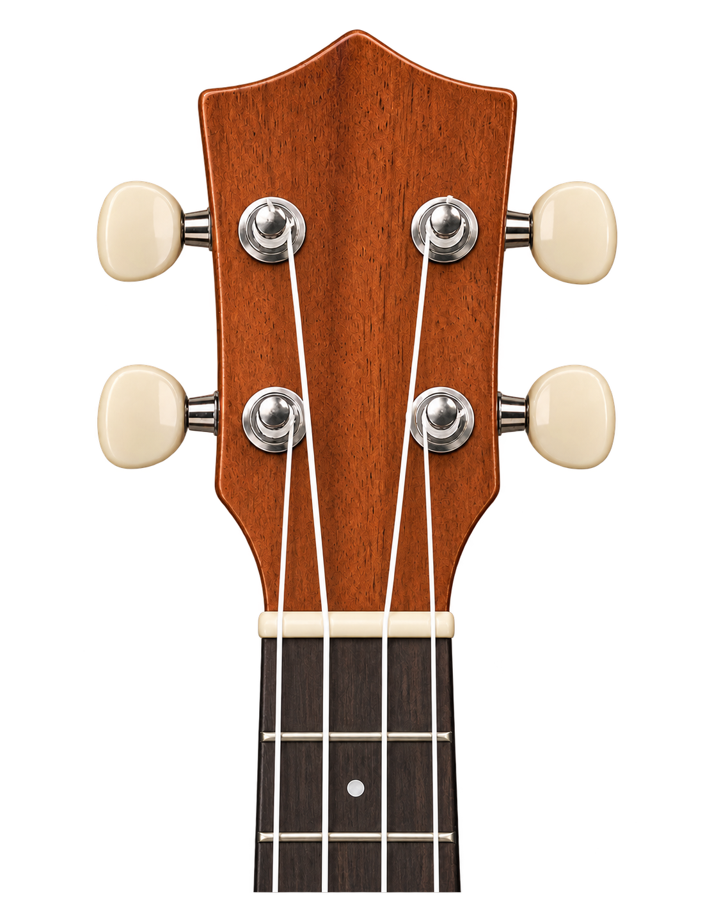
  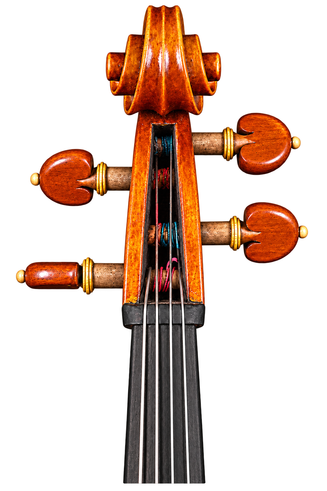
  <br>
  <em>Interactive Headstocks: Acoustic 6-String, Electric Guitar, 4-String Bass, Ukulele, and Violin.</em>
</p>

---

### 5. Instrument Selection Library (`choose_instrument_page.dart`, `instrument_selection_card.dart`)

Used across both the **Chromatic/String Tuner** and **AI Sheet Transcription** workflows, featuring custom visual cards for 12+ string, keyboard, woodwind, and brass instruments:

<p align="center">
  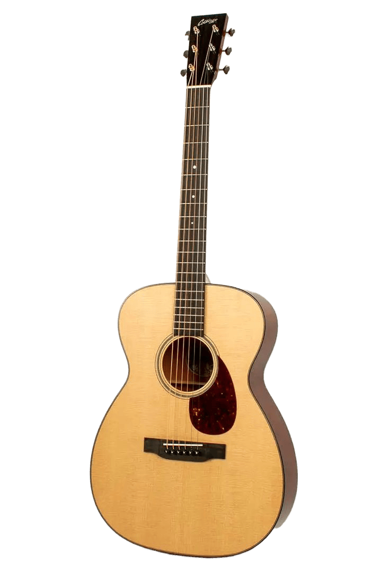
  
  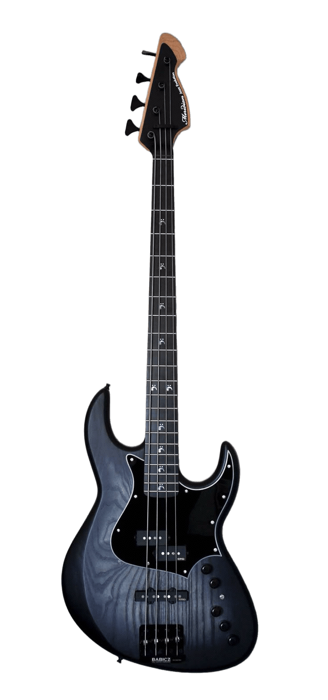
  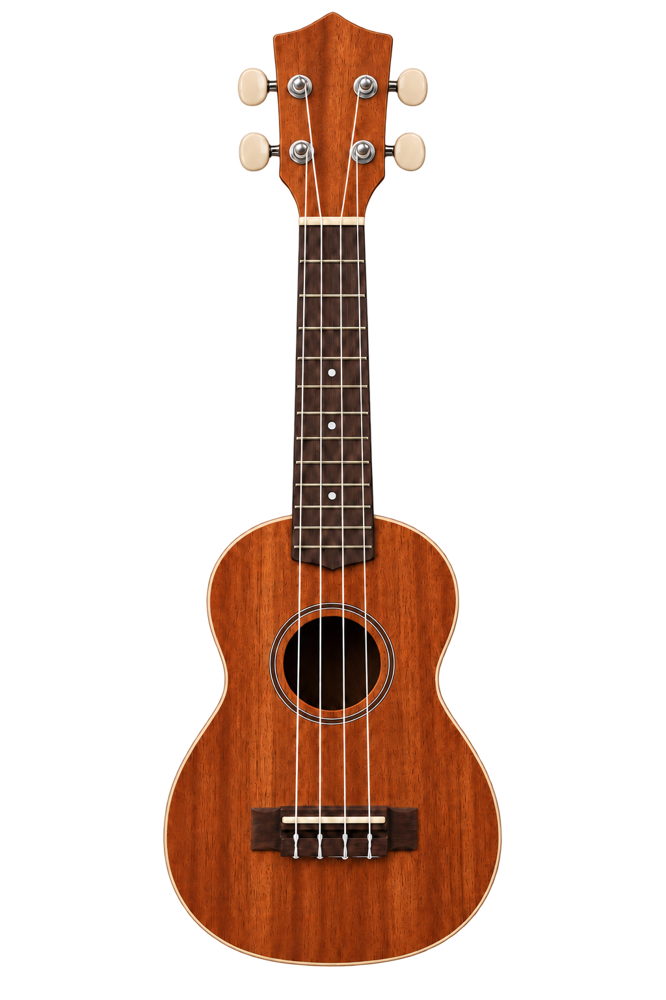
  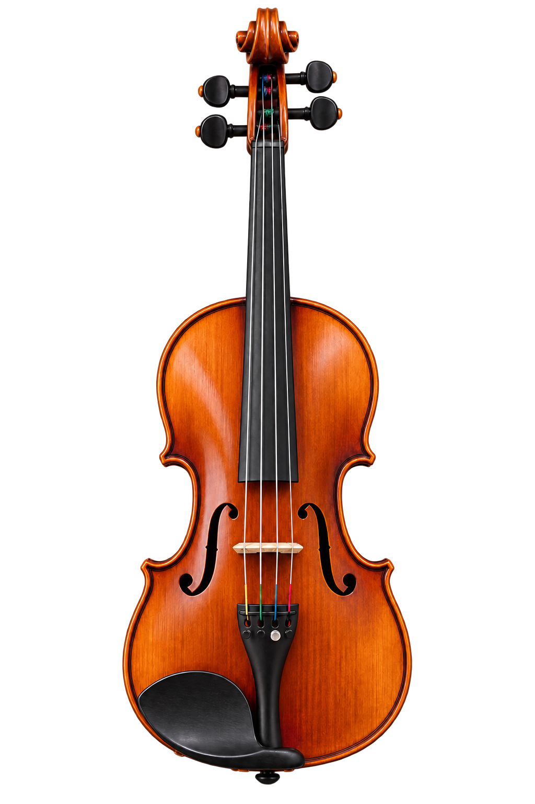
  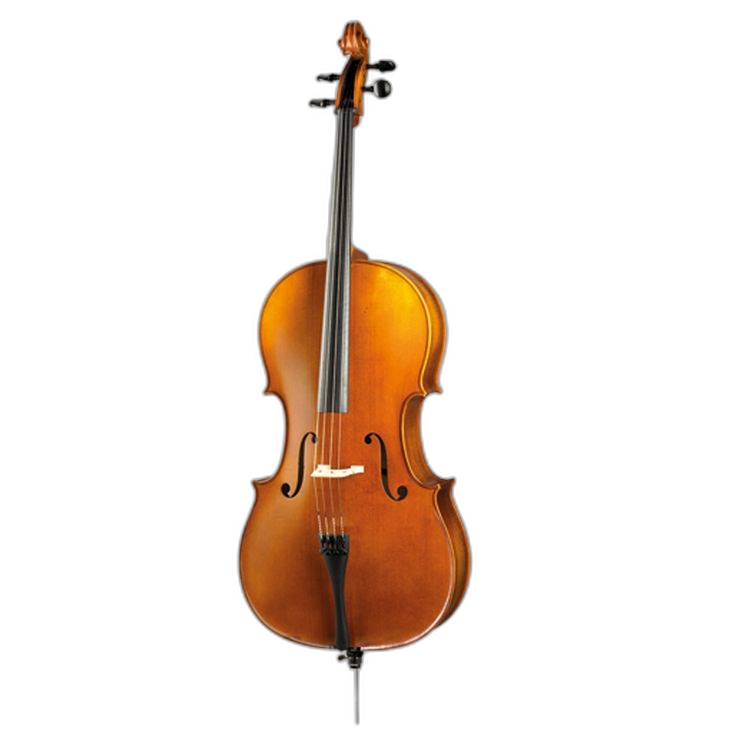
</p>
<p align="center">
  
  
  
  
  
  
  <br>
  <em>Full Instrument Library: Guitar, Electric Guitar, Bass, Ukulele, Violin, Cello, Piano, Saxophone, Trumpet, Flute, Clarinet, and French Horn.</em>
</p>

---

### 6. Haptic Visual Metronome (`metronome_page.dart`, `tap_tempo_page.dart`)

- **Interactive Tempo Dial (`_TempoDial`)**: Supports 1 to 320 BPM with a draggable rotary marker, central large BPM typography, and a fine-grain bottom slider (`_TempoSlider`).
- **Multi-Chromatic Beat Ripple Engine (`_BeatPulsePainter`)**: Releases expanding rainbow wave rings on every beat, with heightened stroke weight on accented downbeats.
- **Tap Tempo & Time Signatures**: Switch to `Tap for beat` mode to calculate BPM from live finger taps, and configure numerator/denominator time signatures (`4/4`, `3/4`, `6/8`, etc.), beat subdivisions, and click sound styles.

<p align="center">
  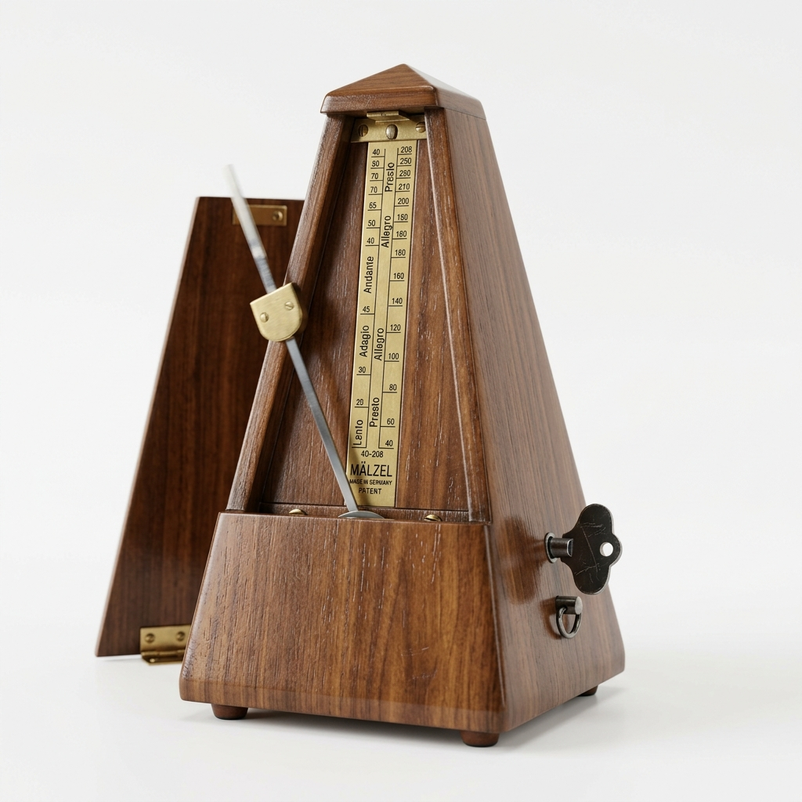
  <br>
  <em>Visual Pulse Metronome with rotary dial, ripple wave canvas, and tempo slider.</em>
</p>

---

### 7. Pitch Detector & Vocal Range Analyzer (`pitch_detector_page.dart`, `voice_range_page.dart`)

- **Live Frequency & Note Readout (`pitch_detector_page.dart`)**: Displays detected Hz frequency, musical note name, octave, and stability graph in real time.
- **Vocal Range Finder (`voice_range_page.dart`)**: Step-by-step guided vocal test capturing the user's lowest chest note and highest head/falsetto note, mapping their voice classification (Bass, Baritone, Tenor, Alto, Mezzo-Soprano, Soprano).

<p align="center">
  
  <br>
  <em>Pitch Detection & Wind/Vocal Performance Analyzer.</em>
</p>

---

### 8. AI Sheet Music Generation & Interactive Note Editor (`choose_mode_page.dart`, `sheet_generation_page.dart`, `music_sheet_page.dart`, `music_note_editor.dart`)

- **Solo vs. Band Mode (`choose_mode_page.dart`, `band_setup_page.dart`)**:
  - **Solo Mode**: Transcribes a single instrument recording or uploaded audio file into clean standard notation.
  - **Band Mode**: Configures multi-instrument parts (`band_part.dart`), separates audio stems, and generates synchronized multi-part scores.
- **Interactive Score Renderer & Note Editor (`music_sheet_page.dart`, `music_note_editor.dart`, `sheet_score_renderer.dart`)**:
  - Tap any notehead on the rendered sheet to change its pitch, accidental, or duration multiple times seamlessly.
  - Interactive walkthrough (`sheet_editor_walkthrough.dart`) guides first-time editors.
  - Built-in MIDI playback with seek guard (`sheet_playback_seek_guard.dart`) and real-time measure highlighting.
- **PDF Preview & Export (`pdf_preview_page.dart`, `sheet_artifact_service.dart`)**: Generates print-ready vector PDF scores and MusicXML files.

<p align="center">
  
  &nbsp;&nbsp;&nbsp;&nbsp;
  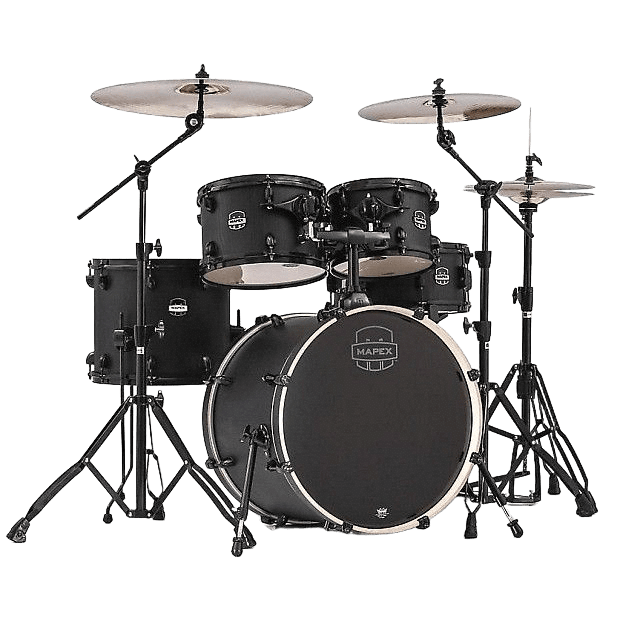
  &nbsp;&nbsp;&nbsp;&nbsp;
  
  <br>
  <em>Solo Mode, Band Mode, and Interactive Sheet Music View & Note Editor.</em>
</p>

---

### 9. Subscription Plans & Quota Management (`plans_page.dart`, `manage_plan_page.dart`)

Transparent tier system tailored to musicians' transcription needs:
- **Free Plan**: Provides **2 Solo** music sheet generations per month. Exported PDFs include the **Augment** watermark; Band mode is not included.
- **Plus Plan (\$2.99 / month)**: Provides **18 Solo** music sheet generations per month **without a watermark**, plus **1 Band mode** allowance (billed according to the number of instruments in the sheet).
- **Pro Plan (\$5.99 / month)**: Provides **55 music sheet generations** per month **without a watermark**, shared flexibly between Solo and Band mode (each Band mode generation deducts credits equal to the number of instruments in the score, e.g., 2 instruments = 2 generations).

---

### 10. Community Hub, Social Feed & Messaging (`social_page.dart`, `create_post_page.dart`, `messages_page.dart`)

- **Musician Feed (`social_page.dart`, `comments_page.dart`)**: Share sheet music arrangements, audio clips, polls, and status updates. Includes distraction-free post creation (`create_post_page.dart`) and expanding search (`social_search_page.dart`).
- **Artist Profiles (`social_profile_page.dart`, `edit_bio_page.dart`, `saved_posts_page.dart`)**: Custom bio, followers/following lists, friend requests (`friend_requests_page.dart`), and bookmarked posts.
- **Real-Time Direct Messaging (`messages_page.dart`, `notifications_page.dart`)**: Chat with fellow musicians, share images, and receive instant activity notifications.

---

### 11. Sheet Music Marketplace & Creator Payouts (`marketplace_page.dart`, `seller_dashboard_page.dart`, `khqr_checkout_view.dart`)

- **Morphing Search & Discovery (`morphing_search_bar.dart`, `marketplace_page.dart`)**: Smoothly expanding search bar with neutral focus styling and responsive product cards designed to fit compact 320px screens up to tablets without text clipping.
- **Listing Creation & Seller Dashboard (`create_marketplace_listing_page.dart`, `seller_dashboard_page.dart`, `seller_payout_page.dart`)**: Publish original sheet music with custom cover art, set pricing, track sales analytics, and request payouts.
- **Bakong KHQR Checkout (`khqr_checkout_view.dart`, `bakong_payment_service.dart`, `marketplace_Purchases_page.dart`)**: Instant QR code payment generation and verification for purchasing scores.

<p align="center">
  
  <br>
  <em>Augment Sheet Music Marketplace Banner & Storefront.</em>
</p>

---

## 🏗️ Complete Module Map (`frontend/lib/`)

| Module Category | Source Files | Detailed Responsibility |
| :--- | :--- | :--- |
| **Core & Theme** | `main.dart`, `home_page.dart`, `app_palette.dart`, `app_settings.dart`, `api_config.dart`, `supabase_config.dart`, `app_update_prompt.dart` | Theme management (Light/Dark), neutral input focus borders, API routing, OTA APK update checks, and bottom navigation shell. |
| **Splash & Mascot** | `splash_screen.dart`, `vector_splash_screen.dart`, `splash_pan_route.dart`, `augment_logo_motion.dart`, `app_logo.dart`, `animated_mascot.dart` | Vector logo animations, custom page transitions, and interactive bunny mascot states. |
| **Authentication** | `login_page.dart`, `verification_code_page.dart`, `welcome_name_page.dart`, `auth_service.dart`, `firebase_options.dart` | Email, Phone OTP, and Google Sign-In flows with session persistence. |
| **Instrument Tuner** | `tuner_page.dart`, `choose_tuner_instrument_page.dart`, `tuner_audio.dart`, `tuner_detector.dart`, `tuner_pitch.dart`, `tuner_sheet.dart` | Live mic capture, pitch detection, cent deviation meter, and coordinate-mapped headstock peg overlays. |
| **Metronome & Pitch** | `metronome_page.dart`, `metronome_sheet.dart`, `tap_tempo_page.dart`, `pitch_detector_page.dart`, `pitch_detector_sheet.dart`, `pitch_tester_sheet.dart`, `voice_range_page.dart`, `tools_page.dart` | Low-latency audio click pools, concentric beat ripples, tap tempo, and vocal range classification. |
| **AI Sheet Generation & Editor** | `choose_mode_page.dart`, `choose_instrument_page.dart`, `band_setup_page.dart`, `band_part.dart`, `sheet_generation_page.dart`, `generation_started_page.dart`, `loading_page.dart`, `music_sheet_page.dart`, `music_note_editor.dart`, `sheet_score_renderer.dart`, `sheet_edit_document.dart`, `pdf_preview_page.dart`, `saved_sheets_page.dart` | Solo/Band audio transcription, interactive multi-tap note editing, MIDI playback cursor, and watermark/clean PDF export. |
| **Social Network** | `social_page.dart`, `social_profile_page.dart`, `social_search_page.dart`, `create_post_page.dart`, `comments_page.dart`, `messages_page.dart`, `friend_requests_page.dart`, `notifications_page.dart`, `saved_posts_page.dart` | Community posts, polls, comments, direct messages, friend system, and notifications. |
| **Marketplace & Payments** | `marketplace_page.dart`, `create_marketplace_listing_page.dart`, `marketplace_purchases_page.dart`, `seller_dashboard_page.dart`, `seller_payout_page.dart`, `khqr_checkout_view.dart`, `bakong_payment_service.dart`, `plans_page.dart`, `manage_plan_page.dart` | Sheet music storefront, seller analytics, subscription tiers (Free/Plus/Pro), and Bakong KHQR payments. |

---

## ⚙️ Local Development & Build Instructions

### 1. Start the Python AI Transcription Server (Port 5000)
```powershell
.\backend\python\start.bat
```
*(Or manually activate `.\backend\python\venv311\Scripts\Activate.ps1` and run `python app.py`)*

### 2. Start the Node.js API Server (Port 3000)
```powershell
.\backend\start.bat
```

### 3. Run the Flutter Mobile App
Debugging on a USB-connected Android device uses `adb reverse` and defaults to `http://127.0.0.1:3000` (or `http://10.0.2.2:3000` on the Android emulator):
```powershell
cd frontend
flutter pub get
flutter run
```

### 4. Build Signed Release APKs
```powershell
.\scripts\build_android_release.ps1 -Publish
```

---

## 🗄️ Database Migrations

The ordered SQL migrations are located in `supabase/migrations`. To link and push to a Supabase project:
```powershell
supabase link --project-ref YOUR_PROJECT_REF
supabase db push
```

---

## 🛡️ GitHub Terms of Service & Compliance Statement

- **No Secrets or Credentials**: All API URLs, keys, and tokens are injected at build/runtime via environment variables (`--dart-define` / `.env`) and are never hardcoded in source documentation.
- **Original & Authorized Assets**: All UI screenshots, mascot illustrations, and instrument graphics are original project assets created for Augment.
- **Community Standards**: This documentation and repository strictly adhere to GitHub's Acceptable Use Policies and Terms of Service.
