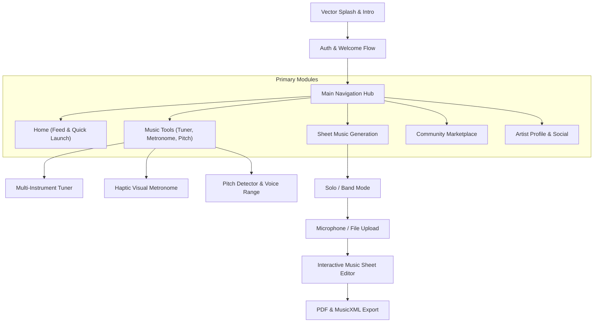

# Augment — UI Display & Architectural Design Specification

A comprehensive technical and visual breakdown of the user interface, navigation flows, and design systems for the **Augment** mobile music workstation.

---

## 1. Design System & Visual Foundation

The application uses **Instrument Sans** typography with a bold, clean aesthetic reminiscent of modern creative and musical hardware interfaces.

### Core Color Palette
- **Brand Accent Red**: `#BA0007` (primary brand identity, interactive highlights, active strings, metronome pulse)
- **Tuning Green**: `#23834D` (pitch accuracy, in-tune status feedback, successful actions)
- **Warning / Sub-accent**: `#D97706` / Amber (tempo alert, warning states)
- **Surface & Backgrounds**:
  - Light mode: Pure `#FFFFFF`, `#F8F9FA` cards, `#E5E7EB` borders
  - Dark mode: Deep Obsidian `#121214`, Elevated `#1C1C1E`, Charcoal borders `#2C2C2E`
- **Typography Tone**: High contrast `#1D1D1F` (Dark: `#F5F5F7`), Muted `#71717A` (Dark: `#A1A1AA`)

---

## 2. Navigation Architecture

Augment utilizes an intuitive multi-tab scaffold accompanied by contextual modal sheets and full-screen creative workflows.

---

## 3. Screen-by-Screen UI Display Specifications

### 3.1 Authentication & Onboarding
- **Vector Splash Screen (`vector_splash_screen.dart`, `splash_screen.dart`)**:
  - Dynamic vector branding with fluid fade transitions.
  - Automatic detection of stored Supabase session credentials.
- **Login & Register (`login_page.dart`, `welcome_name_page.dart`)**:
  - Phone and email authentication with animated SMS/verification OTP inputs (`verification_code_page.dart`).
  - Google OAuth single-tap sign-in option.
  - Floating label input fields with subtle focus styling.

---

### 3.2 Music Tools Module (`tools_page.dart`)

#### A. Instrument Tuner (`tuner_page.dart`, `choose_tuner_instrument_page.dart`)
- **Tuning Header**:
  - Left-aligned active instrument badge (`Guitar 6-String`, `Ukulele`, `Bass`, `Violin`, `Cello`, etc.).
  - Real-time listening indicator with pulsing microphone icon.
  - Segmented toggle chip: `Auto` (automatic note tracking) vs. `Manual` (target locked).
- **Pitch Meter**:
  - Large dynamic note display (`E2`, `A2`, `D3`, `G3`, `B3`, `E4`) dynamically shifting from Brand Red to Forest Green when accurate.
  - Precision Cents Deviation Bar with tick marks (`b` / `#`) tracking pitch variance within ±50 cents.
- **Interactive Headstock Graphic**:
  - Photorealistic headstock rendering tailored to each instrument.
  - Tuning pegs mapped to exact coordinate nodes.
  - Active string ray / laser line connecting the selected tuning key to the locked peg indicator.
  - Glowing ambient halo around the locked peg.
  - **Responsive Layout**: Specially tuned vertical spacing for foldable screens (e.g. Galaxy Z Fold 4) and tablets so the headstock sits cleanly below prompt guidance without overlapping.

#### B. Visual Pulse Metronome (`metronome_page.dart`, `tap_tempo_page.dart`)
- **Central Dial Visualizer**:
  - Oversized radial tempo dial with smooth rotational knob marker.
  - Large digital BPM readout (1 to 320 BPM) with fluid numeric transitions.
  - **Color-Coded Pulse Wave**: Expands outward in concentric multi-chromatic ripple rings on every downbeat.
  - Distinct accent animation on beat 1 of each measure.
- **Controls & Time Signatures**:
  - Horizontal drag tempo slider for micro-adjustments.
  - Tap-tempo floating chip allowing musicians to tap any rhythm to calculate tempo.
  - Time signature modal (2/4, 3/4, 4/4, 6/8, etc.) and subdivision configuration.

#### C. Pitch Detector & Vocal Range (`pitch_detector_page.dart`, `voice_range_page.dart`)
- Live audio FFT spectrum visualizer converting detected audio frequencies to staff notes and octave indicators in real time.
- Voice range test wizard detecting lowest comfortable pitch to highest falsetto/head voice note.

---

### 3.3 Sheet Music Generation & Score Editor

#### A. Generation Workflow (`choose_mode_page.dart`, `sheet_generation_page.dart`)
- **Mode Selection**:
  - **Solo Mode**: Single-instrument acoustic/polyphonic transcription.
  - **Band Mode**: Multi-track stem separation and multi-stave score layout.
- **Audio Capture**:
  - Real-time studio microphone recorder with waveform visualizer.
  - Audio file importer supporting MP3, WAV, M4A, and FLAC.
- **Transcription Loading Indicator (`app_loading.dart`)**:
  - Step-by-step progress tracker indicating spectral separation, pitch extraction, and notation formatting.

#### B. Interactive Music Sheet Editor (`music_sheet_page.dart`, `music_note_editor.dart`)
- **Score Canvas**:
  - High-fidelity score rendering supporting standard notation, clefs, key signatures, and accidentals.
  - Interactive note selection: tap any notehead to open the pitch/accidental adjustment wheel.
  - Playback cursor tracking note playback in sync with synthesized MIDI audio.
- **Action Toolbar**:
  - Play / Pause transport controls.
  - Measure add/delete, tempo selector, and time signature adjustments.
  - PDF Export Preview (`pdf_preview_page.dart`) and MusicXML download triggers.

---

### 3.4 Community Marketplace (`marketplace_page.dart`)

- **Morphing Search Header (`morphing_search_bar.dart`)**:
  - Search input that smoothly animates and morphs into category filter chips (Classical, Jazz, Pop, Rock, Acoustic).
  - Clean focus borders ensuring distraction-free typing.
- **Product Card Grid & Search List**:
  - 2-line title wrapping with automatic ellipsis to prevent overflow on small screens.
  - Instrument badge, price pill, and composer credit.
  - High-resolution sheet preview thumbnail.
- **Creator Dashboard (`seller_dashboard_page.dart`, `create_marketplace_listing_page.dart`)**:
  - Revenue graphs, active listing management, and Bakong KHQR checkout integration (`khqr_checkout_view.dart`).

---

### 3.5 Social Hub (`social_page.dart`, `social_profile_page.dart`)

- **Community Feed**:
  - Musical snippet audio players, sheet attachments, and rich post compositions (`create_post_page.dart`).
  - Interactive likes, comment drawer (`comments_page.dart`), and sheet sharing.
- **Artist Profile**:
  - Bio editor, follower counters, verified artist badges, and portfolio of published arrangements.
  - Direct messaging (`messages_page.dart`) and friend request management (`friend_requests_page.dart`).

---

## 4. Multi-Form Factor & Screen Adaptability

| Device Category | Target Viewport | Layout Strategy |
|---|---|---|
| **Compact Phones** | 320px – 360px width | Compressed single-column layout, constrained text wrapping, adaptive card minimum heights |
| **Standard Smart Devices** | 375px – 430px width | Full feature hierarchy, balanced 20dp edge gutters, comfortable touch targets (48x48dp min) |
| **Foldables (Fold 4 Unfolded)** | 670px – 768px width | Expanded aspect ratio adjustments, increased top offsets on instrument headstocks, centered dial layouts |
| **Tablets & Desktop/Web** | 768px+ width | Dual-pane split screens (Tools/Editor controls on left, interactive sheet/canvas on right) |

---

## 5. Compliance & Clean Publishing Standards
- **No Private Credentials**: All API targets and secret keys reference environment variables (`String.fromEnvironment`).
- **No Direct Third-Party Proprietary Media**: All iconography uses standard Flutter Material & Cupertino icons or original SVG vector artwork.
- **Open Standards**: Fully compliant with GitHub Community Guidelines, Terms of Service, and open-source documentation standards.
