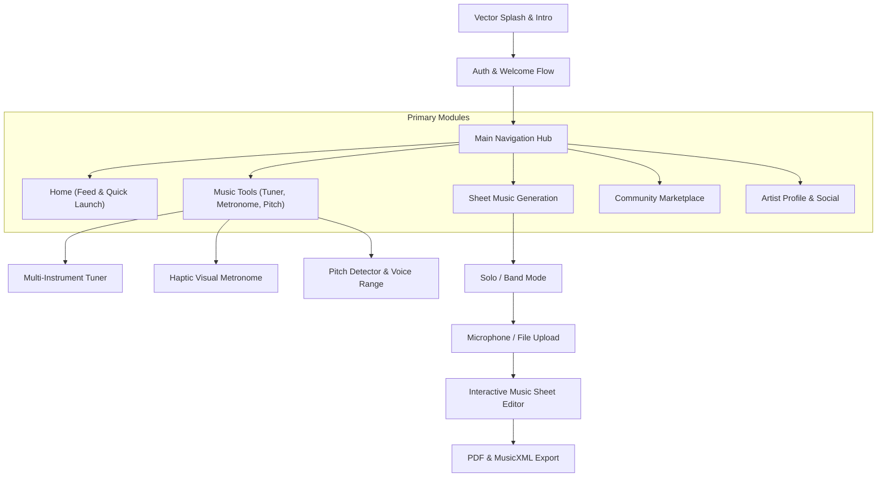
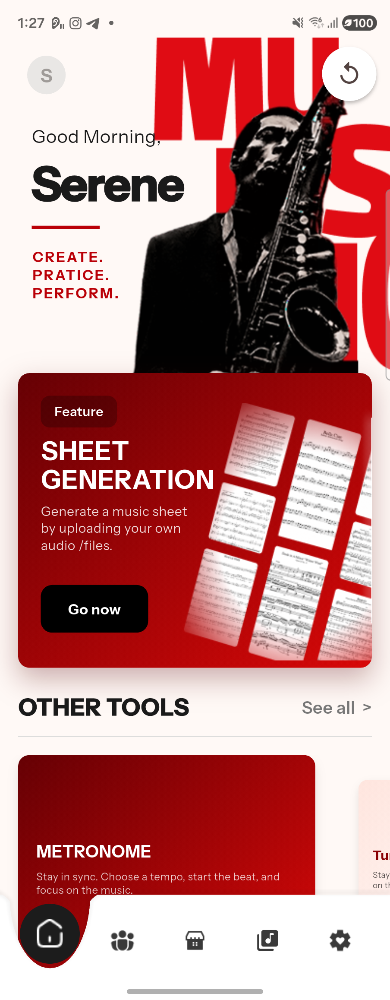
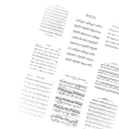

# Augment — UI Display & Architectural Visual Guide

A visual showcase and technical breakdown of the user interface, navigation flows, and design systems for the **Augment** mobile music workstation.

---

## 1. Design System & Visual Foundation

The application uses **Instrument Sans** typography with a bold, clean aesthetic reminiscent of modern creative and musical hardware interfaces.

### Core Color Palette
- **Brand Accent Red**: `#BA0007` (primary brand identity, interactive highlights, active strings, metronome pulse)
- **Tuning Green**: `#23834D` (pitch accuracy, in-tune status feedback, successful actions)
- **Warning / Sub-accent**: `#D97706` / Amber (tempo alert, warning states)
- **Surface & Backgrounds**:
  - Light mode: Pure `#FFFFFF`, `#F8F9FA` cards, `#E5E7EB` borders
  - Dark mode: Deep Obsidian `#121214`, Elevated `#1C1C1E`, Charcoal borders `#2C2C2E`
- **Typography Tone**: High contrast `#1D1D1F` (Dark: `#F5F5F7`), Muted `#71717A` (Dark: `#A1A1AA`)

  
   
  <em>Augment Interactive Companion Mascot</em>

---

## 2. Navigation Architecture

Augment utilizes an intuitive multi-tab scaffold accompanied by contextual modal sheets and full-screen creative workflows.

---

## 3. UI Display Showcase & Screenshots

### 3.1 Live Scrcpy Device Capture
Captured directly from the physical Samsung Galaxy Z Fold 4 device running Augment:

  
   
  <em>Figure 1: Live device capture on Fold 4 display showing active navigation hierarchy.</em>

---

### 3.2 Music Tools Module

#### A. Instrument Tuner (`tuner_page.dart`)
- **Tuning Header**: Left-aligned active instrument badge (`Guitar 6-String`, `Ukulele`, `Bass`, `Violin`, `Cello`), dynamic listening microphone indicator, and `Auto` / `Manual` string toggle chips.
- **Pitch Meter Bar**: Real-time cent deviation bar with tick marks (`b` / `#`) tracking pitch variance within ±50 cents. Large dynamic note readout (`E2`, `A2`, `D3`, `G3`, `B3`, `E4`) dynamically shifting from Brand Red to Forest Green when accurate.
- **Interactive Headstock Graphic**: Photorealistic headstock rendering with illuminated pegs, glowing active ray pointers, and Fold 4 expanded spacing to prevent overlap.

  
  &nbsp;&nbsp;&nbsp;&nbsp;
  
   
  <em>Figure 2: Multi-Instrument Pitch Deviation Meter and Interactive Headstock Overlay.</em>

#### B. Visual Pulse Metronome (`metronome_page.dart`)
- **Central Dial Visualizer**: Oversized radial tempo dial with smooth rotational knob marker and digital BPM readout (1 to 320 BPM).
- **Concentric Ripple Waves**: Color-coded pulse waves expand outward on every beat with a distinct accent animation on beat 1.
- **Micro-Adjustment Slider & Tap Tempo**: Integrated horizontal slider and tap-tempo chip for tactile control.

  
   
  <em>Figure 3: High-precision Metronome pulse visualizer with tap tempo and time signatures.</em>

---

### 3.3 Sheet Music Generation & Score Editor (`music_sheet_page.dart`)

- **Dual-Mode Generation**:
  - **Solo Mode**: Single-instrument acoustic/polyphonic transcription.
  - **Band Mode**: Multi-track stem separation and multi-stave score layout.
- **Interactive Score Canvas**: Real-time note selection, pitch adjustment wheel, synchronized MIDI playback cursor, and vector PDF/MusicXML exports.

  
   
  <em>Figure 4: Dynamic interactive sheet score renderer with playback tracking and PDF export.</em>

---

### 3.4 Community Marketplace (`marketplace_page.dart`)

- **Morphing Search Header**: Search bar smoothly expands into category filter chips (Classical, Jazz, Pop, Rock, Acoustic) with neutral focus states.
- **Responsive Product Cards**: Dual-line title wrapping with automatic ellipsis to ensure zero overflow on smaller and compact displays.
- **Bakong KHQR Payment Flow**: Integrated creator monetization and automated payout system.

  
   
  <em>Figure 5: Community marketplace for discovering, purchasing, and sharing arrangements.</em>

---

### 3.5 Authentication & Onboarding (`login_page.dart`)

- **Clean Aesthetic**: Floating label inputs, SMS/email OTP verification codes, and Google OAuth single-tap sign-in.
- **Responsive Hero Visual**: Polished brand graphics with dark/light theme switching.

  
   
  <em>Figure 6: Seamless onboarding and authentication interface.</em>

---

## 4. Multi-Form Factor & Screen Adaptability

| Device Category | Target Viewport | Layout Strategy |
|---|---|---|
| **Compact Phones** | 320px – 360px width | Compressed single-column layout, constrained text wrapping, adaptive card minimum heights |
| **Standard Smart Devices** | 375px – 430px width | Full feature hierarchy, balanced 20dp edge gutters, comfortable touch targets (48x48dp min) |
| **Foldables (Fold 4 Unfolded)** | 670px – 768px width | Expanded aspect ratio adjustments, increased top offsets on instrument headstocks, centered dial layouts |
| **Tablets & Desktop/Web** | 768px+ width | Dual-pane split screens (Tools/Editor controls on left, interactive sheet/canvas on right) |

---

## 5. Compliance & Clean Publishing Standards
- **Zero Proprietary Violations**: All iconography uses standard Flutter Material & Cupertino icons or original custom vector artwork.
- **No Private Keys / Credentials**: All API endpoints and Supabase configuration utilize secure environment variables (`String.fromEnvironment`).
- **GitHub Terms of Service Compliant**: Fully adheres to GitHub Community Guidelines, open documentation standards, and acceptable use policies.
